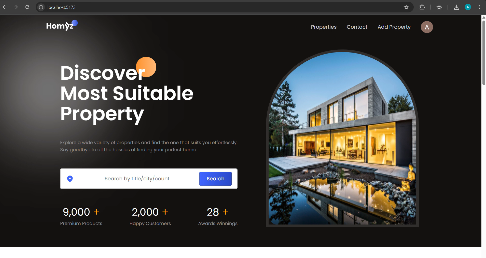
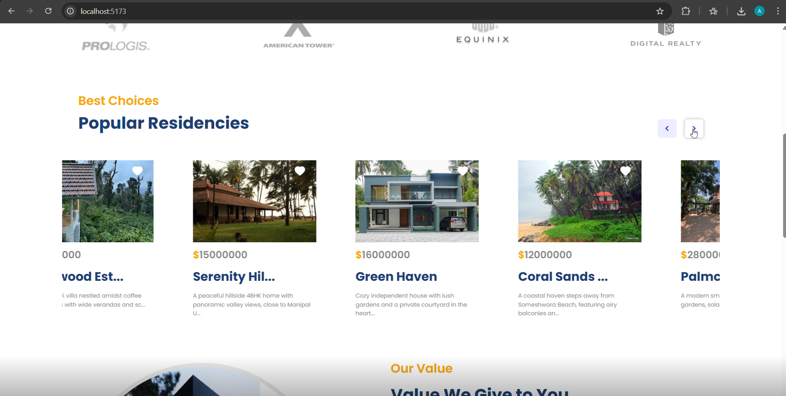
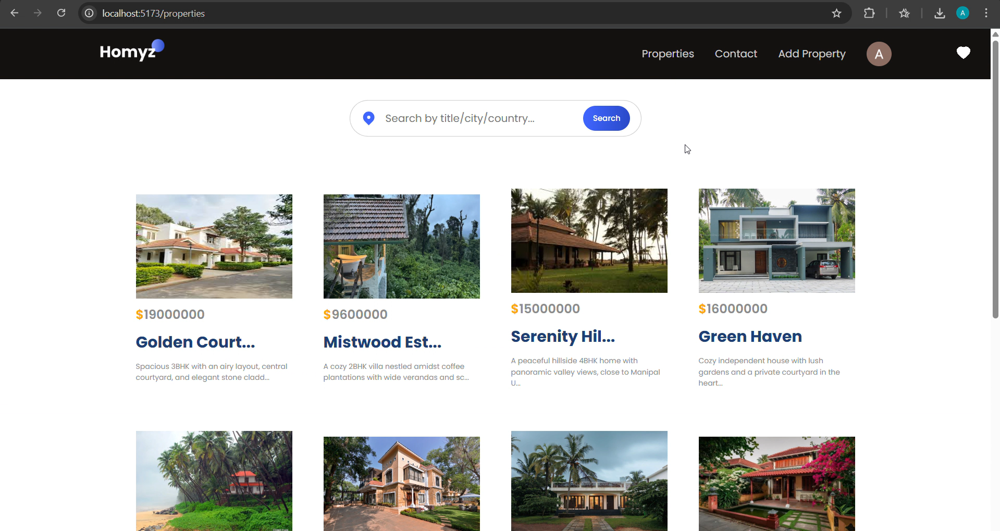
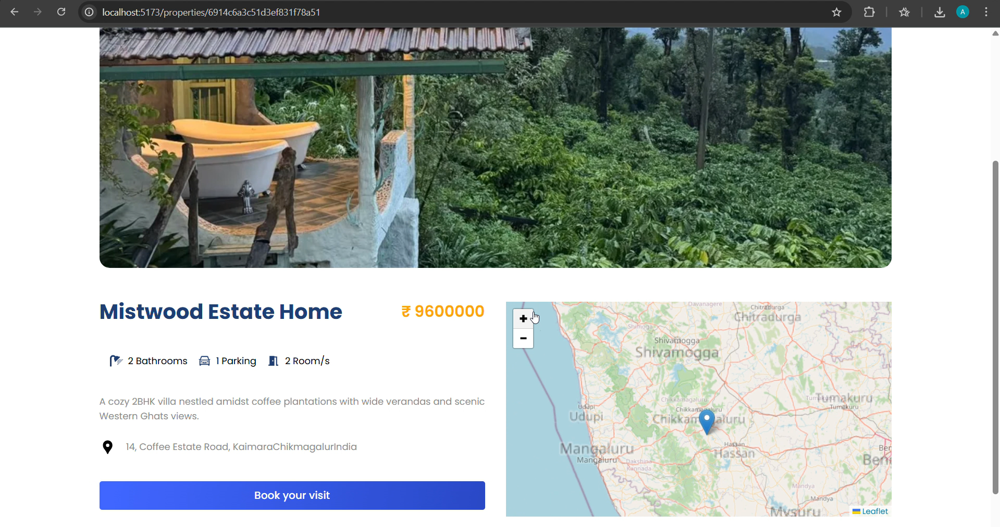
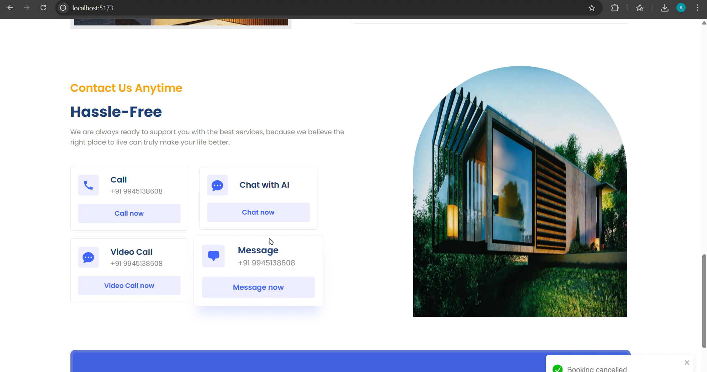

# Real Estate Platform with AI Assistant

A full-stack real estate web application integrating property discovery, interactive geographical mapping, visit scheduling, and an AI-driven conversational assistant powered by Google Gemini.

---

## Overview

Homyz provides a modern interface for users to browse, search, and manage residential property listings. The platform incorporates an intelligent assistant capable of understanding natural language search queries, filtering real estate listings dynamically based on location, budget, and amenities, and answering user inquiries in real time.

---

## User Interface

### Home Page


### Featured Residencies


### Property Catalog & Search


### Property Detail View & Geolocation


### Inquiry & AI Assistant


---

## Core Capabilities

- **Intelligent Property Search**: Real-time filtering by property title, municipality, or region.
- **Conversational AI Integration**: An embedded assistant using Google Gemini API (`gemini-2.5-flash` with fallback routing) to interpret natural language property inquiries (e.g., specific property styles, regional requests, or budget constraints).
- **Interactive Mapping**: Geographic visualization and dynamic location pinning using Leaflet and OpenStreetMap.
- **Visit Scheduling**: Integrated calendar module allowing authenticated users to schedule and manage property walkthroughs.
- **Favorites & Wishlist**: Persistent tracking of user-favorited listings tied to user profiles.
- **Listing Management**: Form workflow for publishing new properties, including image uploads, structural details, and pricing.
- **Identity & Access Management**: Secure user authentication and token-based API authorization via Auth0 (OAuth 2.0 / RS256 JWT validation).

---

## System Architecture & Tech Stack

### Frontend Architecture
- **Framework**: React 18, Vite
- **Component Library**: Mantine Core
- **Mapping & Geolocation**: Leaflet, React-Leaflet
- **Carousels & Media**: Swiper.js
- **State & Server Communication**: TanStack React Query, Axios
- **Authentication**: Auth0 React SDK

### Backend Architecture
- **Runtime**: Node.js, Express.js
- **Database & Data Modeling**: MongoDB Atlas, Prisma ORM
- **AI Processing**: Google Generative AI (Gemini REST API)
- **Security & Authorization**: Express OAuth2 JWT Bearer (`express-oauth2-jwt-bearer`)

---

## Project Structure

```
├── client/                 # React frontend application
│   ├── public/             # Static assets and branding
│   ├── src/
│   │   ├── components/     # Reusable UI components (Chatbot, Map, Cards, etc.)
│   │   ├── hooks/          # Custom React hooks (Data fetching & auth checks)
│   │   ├── pages/          # View routing (Home, Properties, Bookings, Favorites)
│   │   └── utils/          # API layer and helper functions
│   └── vite.config.js      # Vite build configuration
│
├── server/                 # Express backend API
│   ├── config/             # Auth0 and Prisma client configurations
│   ├── controllers/        # Route business logic (Residency and User handlers)
│   ├── prisma/             # Database schema and migration specifications
│   ├── routes/             # API routing endpoints (Chat, Residency, User)
│   └── utils/              # Smart filtering engine and query helpers
│
└── screenshots/            # UI reference screenshots
```

---

## Installation & Setup

### Prerequisites
- Node.js (version 18 or higher)
- npm or yarn package manager
- MongoDB Atlas account (or compatible MongoDB instance)
- Google AI Studio API key
- Auth0 developer account

---

### Backend Configuration

1. Navigate to the server directory:
   ```bash
   cd server
   ```

2. Install dependencies:
   ```bash
   npm install
   ```

3. Configure environment variables:
   Create a `.env` file in the `server` root following the provided template:
   ```bash
   cp .env.example .env
   ```

4. Populate `.env` with your deployment credentials:
   ```env
   PORT=8000
   DATABASE_URL="mongodb+srv://<username>:<password>@cluster0.example.mongodb.net/<dbname>?retryWrites=true&w=majority"
   GEMINI_API_KEY="<your-google-gemini-api-key>"
   AUTH0_AUDIENCE="http://localhost:8000"
   AUTH0_ISSUER_BASE_URL="https://<your-auth0-domain>.auth0.com"
   ```

5. Generate the Prisma database client:
   ```bash
   npx prisma generate
   ```

6. Start the development server:
   ```bash
   npm run dev
   ```
   The backend service starts at `http://localhost:8000`.

---

### Frontend Configuration

1. Open a separate terminal and navigate to the client directory:
   ```bash
   cd client
   ```

2. Install dependencies:
   ```bash
   npm install
   ```

3. Launch the Vite development server:
   ```bash
   npm run dev
   ```
   The application will be accessible at `http://localhost:5173`.

---

## Security Guidelines

- Sensitive credentials (database connection strings, API keys, and authentication parameters) must never be committed to source control.
- Ensure all deployment configurations utilize environment-specific variable injection.
- Reference `.env.example` across environments for onboarding without exposing live secrets.

---

## License

This project is licensed under the MIT License.
